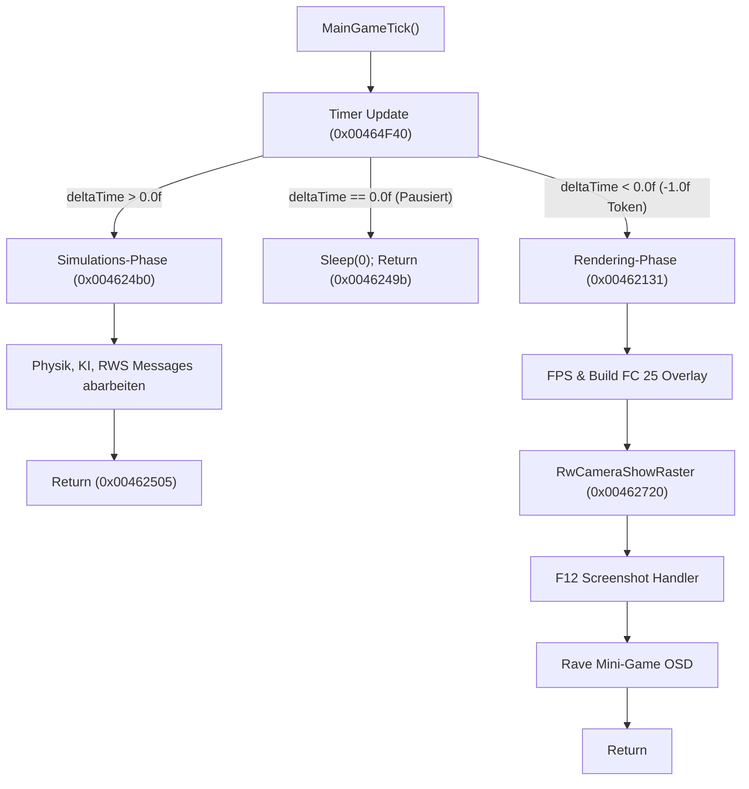

# Madagascar (PC, 2005) - Decompilation Architecture & Reverse Engineering Ledger

Dieses Dokument dient als zentrale Wissensbasis für die Dekompilation von **Madagascar (PC)** (entwickelt von Toys for Bob / Beenox / Activision, Release: Mai 2005).

---

## 1. Binary-Analyse & PE-Vergleich

Im Spielverzeichnis wurden zwei `.exe`-Dateien analysiert:

| Eigenschaft | `game\Madagascar\Launcher.exe` | `game\Madagascar\Game\Game.exe` |
| :--- | :--- | :--- |
| **Dateigröße** | 5.038.080 Bytes (~4,80 MB) | 2.342.912 Bytes (~2,23 MB) |
| **PE Timestamp** | `2005-04-12 12:38:51 UTC` | `2005-04-12 14:41:41 UTC` |
| **Compiler / Linker** | MSVC 7.1 (Visual Studio .NET 2003) | MSVC 7.1 (Visual Studio .NET 2003) |
| **PE Subsystem** | Win32 GUI (`0x0002`) | Win32 GUI (`0x0002`) |
| **Image Base** | `0x00400000` | `0x00400000` |
| **Entry Point (RVA)** | `0x00052BE9` (VA `0x00452BE9`) | `0x0015A0B2` (VA `0x0055A0B2`) |
| **Anzahl Sektionen** | 4 (`.text`, `.rdata`, `.data`, `.rsrc`) | 8 (`.text`, `_rwcseg`, `.rdata`, `.data`, `_rwdseg`, `.data1`, `.rsrc`, `.reloc`) |
| **Kopierschutz / DRM** | Unpacked (Kein SecuROM, kein SafeDisc) | Unpacked (Kein SecuROM, kein SafeDisc) |
| **Packer / Crypter** | Keiner (Code-Entropie 6.68) | Keiner (Code-Entropie 6.52) |
| **Grafik / Engine** | Nur GDI32 / Standard-Win32-GUI | **Direct3D 8 (`d3d8.dll`), RenderWare 3.x, Bink Video (`binkw32.dll`), DirectSound (`DSOUND.dll`)** |
| **Rolle im Projekt** | CD-Autorun / Menü-Launcher | **Echte, native Haupt-Spiel-Binary!** |

### Fazit zur Ziel-Binary
`Launcher.exe` ist lediglich ein Frontend zur Sprachauswahl und Installationsprüfung; die `.rsrc`-Sektion enthält über 4,2 MB an PNG-Bildern für den Launcher-Dialog.
**`Game.exe` ist die eigentliche, vollständig unverschlüsselte und unkomprimierte Haupt-Spiel-Binary.** Sie enthält den kompletten RenderWare 3.x Engine-Core, Toys for Bob Custom-Plugins (`CTFB*`) und das Game-Framework.

---

## 2. Memory Layout & PE-Sektionen (`Game.exe`)

| Sektion | Virtuelle Adresse (VA) | Virtuelle Größe | Roh-Offset (Datei) | Roh-Größe | Zweck / Inhalt |
| :--- | :--- | :--- | :--- | :--- | :--- |
| `Headers` | `0x00400000` | `0x00001000` | `0x00000000` | `0x00001000` | DOS & PE Header |
| `.text` | `0x00401000` | `0x001C7BA2` | `0x00001000` | `0x001C8000` | Hauptcode (x86 Instruktionen) |
| `_rwcseg` | `0x005C9000` | `0x00000451` | `0x001C9000` | `0x00001000` | **RenderWare Code Segment** (Criterion RWS Hooks) |
| `.rdata` | `0x005CA000` | `0x00037C36` | `0x001CA000` | `0x00038000` | Read-only Daten, String-Tabellen, IAT |
| `.data` | `0x00602000` | `0x00031AA8` | `0x00202000` | `0x00016000` | Globale Variablen, Engine-Singletons |
| `_rwdseg` | `0x00634000` | `0x00000008` | `0x00218000` | `0x00001000` | **RenderWare Data Segment** |
| `.data1` | `0x00635000` | `0x00000900` | `0x00219000` | `0x00001000` | Zusätzliche Initialisierungsdaten |
| `.rsrc` | `0x00636000` | `0x00006490` | `0x0021A000` | `0x00007000` | Ressourcen (Game-Icon ID `103`) |
| `.reloc` | `0x0063D000` | `0x0001A2C6` | `0x00221000` | `0x0001B000` | PE-Relokationen |

---

## 3. Identifizierte Module & Adress-Register

### 3.1. Einstiegspunkt & Anwendungs-Lifecycle
| Adresse | Symbol / Name | Beschreibung |
| :--- | :--- | :--- |
| `0x0055A0B2` | `entry` / `WinMainCRTStartup` | Standard MSVC 7.1 CRT Entry Point; initialisiert Heap, Multi-Threading, I/O und ruft `WinMain` auf. |
| `0x004646F0` | `WinMain` | Win32 Einstiegspunkt: Mutex-Prüfung (`"Madagascar Running"`), Settings laden, Fenster erzeugen, RW initialisieren, Hauptschleife. |
| `0x00464370` | `MainWndProc` | Window-Procedure: Behandelt `WM_DESTROY`, `WM_SETFOCUS`, `WM_KILLFOCUS`, `WM_PAINT`, `WM_CLOSE`, `WM_SYSCOMMAND`, Tastatur & Maus. |
| `0x00519F00` | `CreateGameWindow` | Registriert Fensterklasse (`"RWSConsoleD3D8"`, Icon 103) und ruft `CreateWindowExA` auf. |
| `0x0051A100` | `ProcessWindowsMessages` | Message-Pump (`PeekMessageA`, `TranslateMessage`, `DispatchMessageA`, screensaver keep-alive). |
| `0x004620D0` | `MainGameTick` | Pro-Frame-Update: Timer, Physik, RWS-Nachrichten (`iMsgRunningTick`, `iMsgDoRender`), Screenshot-Handler, FPS-Anzeige (`Build FC 25`). |
| `0x00460D50` | `ShutdownGame` | Level-Entladung & System-Shutdown. |
| `0x00462BC0` | `ShutdownRenderWare` | RenderWare-Shutdown & Ressourcen-Freigabe. |

### 3.2. RenderWare Studio & Grafik-Subsystem
| Adresse | Symbol / Name | Beschreibung |
| :--- | :--- | :--- |
| `0x00462AA0` | `RwEngine_Initialize` | Initialisiert RenderWare (`RwEngineInit`), registriert Plugins, öffnet Engine (`RwEngineOpen`), wählt Videomodus und startet (`RwEngineStart`). |
| `0x00462BF0` | `RwSelectVideoMode` | Iteriert über alle Direct3D-Subsysteme und Videomodi zur Auswahl der besten Auflösung/Farbtiefe. |
| `0x004D7FA0` | `RwEngineGetNumSubSystems` | Ermittelt Anzahl verfügbarer Grafik-Adapter/Subsysteme. |
| `0x004D8050` | `RwEngineSetSubSystem` | Wählt aktives Grafik-Subsystem aus. |
| `0x004D8080` | `RwEngineGetNumVideoModes` | Ermittelt Anzahl Display-Modi für das gewählte Subsystem. |
| `0x004D80B0` | `RwEngineGetVideoModeInfo` | Liest Breite, Höhe, Farbtiefe und Flags eines Videomodus aus. |
| `0x004D8120` | `RwEngineSetVideoMode` | Aktiviert den gewählten Videomodus. |
| `0x004D8260` | `RwEngineStart` | Startet den RenderWare Direct3D 8 Treiber. |
| `0x004D83B0` | `RwEngineOpen` | Öffnet RenderWare mit Fensterhandle (`HWND`). |
| `0x004D8620` | `RwEngineInit` | Kern-Initialisierung der RenderWare-Funktionstabelle (`PTR_FUN_00606c90`). |
| `0x004E8830` | `RwD3D8SetMultisampling` | FSAA-Konfiguration (0 = Aus, 2 = 2x FSAA). |
| `0x00462880` | `RwCreateCameraAndRasters` | Registriert Bildformate (PNG, BMP, RAS, TIF) via Codec-Tabelle `0x005D5D6C`. |
| `0x0044E8E0` | `RwCreateDefaultCameraAndRasters` | Erzeugt Hauptkamera, Z-Buffer, Frame-Buffer, Frame & berechnet 60°-FOV View Window. |
| `0x0044AE20` | `RwRegisterStandardPlugins` | Registriert Criterion Standard-Plugins (`RpWorldPluginAttach`, `RpCollisionPluginAttach`). |
| `0x00465150` | `RwRegisterTFBPlugins` | Initialisiert TFB Async Stream Critical Section (`0x00630F40`, Thread-Priorität `-1`). |
| `0x0045F9A0` | `RwRegisterTFBCustomPlugins` | Master-Registrierer für alle proprietären Toys for Bob RenderWare-Plugins. |
| `0x004627B0` | `RegisterAllExtendedPlugins` | Master-Plugin-Schleife (19 Initialisierer an `0x005D5CF0` inkl. Skin `0x11D`, HAnim `0x12A`). |
| `0x00432CB0` | `InitGameWorldManager` | Ermittelt Anzahl aktiver Welten aus dynamischem Vektor `0x0061F878`. |
| `0x004627E0` | `LoadLevelStream` | Lädt Level-Streams synchron (`RwStreamOpen` / `0x00552F70`) oder asynchron (`0x00465C40`). |

### 3.3. Toys for Bob (TFB) Engine-Architektur

Die Spiel-Engine basiert auf RenderWare Studio 3.x, erweitert durch proprietäre TFB-Subsysteme, Entity-Deskriptoren und RenderWare-Plugins:

#### A. Toys for Bob RWS Entity-Klassen & Deserializer
Jede TFB-Klasse besitzt einen statischen Klassen-Deskriptor in `.data` und eine Stream-Deserialisierungsfunktion:

1. **`CTFBWorld`**:
   - **Deskriptor**: `0x00602EC8` (String `"CTFBWorld"` an `0x005CCB24`)
   - **Konstruktor / Stream-Reader**: `0x0041B640`
   - **Speicher-Layout & Member-Offsets**:
     | Offset | Typ | Name | Beschreibung |
     | :--- | :--- | :--- | :--- |
     | `0x00` | `void*` | `m_pVTable` | Virtuelle Funktionstabelle (`0x005D56A4`) |
     | `0x04` | `uint32_t` | `m_dwFlags` | Entity-Statusflags (Bit 1 = aktiv) |
     | `0x20` | `void*` | `m_pBSPRenderFn` | BSP Sector Render-Funktion (`0x0041B5F0` / `0x0041B150`) |
     | `0x24` | `uint32_t` | `m_dwRenderFlags` | Rendering-Flags |
     | `0x2C` | `char[8]` | `m_szCameraLink1` | Primäre Kamera-Verknüpfung (`"RwCamera*"`, `0x00550440`) |
     | `0x34` | `char[8]` | `m_szCameraLink2` | Sekundäre Kamera-Verknüpfung |
     | `0x3C` | `char[8]` | `m_szCameraLink3` | Tertiäre Kamera-Verknüpfung |
     | `0x44` | `void*` | `m_pSkyDome` | Sky-Dome / Horizont-Geometrie |
   - **Verwaltete Engine-Attribute (.data)**:
     - Welt-Geometrie: `RpWorld*` an `0x00629724` (`0x004B8570`)
     - Clipping Planes: Near Clip `0x00629710` (0.1 .. 6.0), Far Clip `0x0062970C` (5000.0)
     - Schattenmodus: `0x00629700` (0 = Aus, 1 = Blob, 2 = Projektiv, 3 = Detailliert)
     - Nebel-Parameter: Start `0x006296F8`, Ende `0x006296F4`, Linear `0x006296F0`, Dichte `0x00617D98` (* 12.0)
     - Nebel-Aktivierung: Master `0x00617D5C`, Volumetrisch `0x00617D95`
     - Nebelfarben: ARGB-Werte an `0x00617D60` .. `0x00617D63`

2. **`CTFBModel`**:
   - **Deskriptor**: `0x00603548` (String `"CTFBModel"` an `0x005D4DD4`)
   - **Konstruktor / Stream-Reader**: `0x00444FB0`
   - **Speicher-Layout & Member-Offsets**:
     | Offset | Typ | Name | Beschreibung |
     | :--- | :--- | :--- | :--- |
     | `0x00` | `void*` | `m_pVTable` | Virtuelle Funktionstabelle (`0x005D5714`) |
     | `0x04` | `uint32_t` | `m_dwFlags` | Entity-Statusflags |
     | `0x1C` | `uint32_t` | `m_nBoneCount` | Gesamtzahl der Skelettknochen |
     | `0x20` | `CTFBBoneNode*` | `m_pBones` | Dynamisches Knochen-Array (64 Bytes / `0x40` pro Knochen) |
     | `0x24..0x47` | `void*[9]` | `m_pHAnimAnims` | Primäre HAnim-Animations-Handles (`"rwID_HANIMANIMATION"`) |
     | `0x48` | `uint8_t` | `m_bAnimValid` | Gültigkeitsflag primäre Animationen |
     | `0x4C` | `int32_t` | `m_nMouthBoneId` | Gesichts-/Mundknochen-ID (`TFB_MESH.MOUTH_BONE_ID`, `0x00444AD0`) |
     | `0x50..0x5F` | `void*[4]` | `m_pSecondaryAnims` | Sekundäre Animations-Handles |
     | `0x60` | `uint8_t` | `m_bSecondaryValid` | Gültigkeitsflag sekundäre Animationen |
     | `0x64` (100) | `int32_t` | `m_nEyeUpperLeftBoneId` | Knochen-ID Auge oben links (`TFB_MESH.EUL_BONE_ID`, `0x00444B60`) |
     | `0x68` (104) | `int32_t` | `m_nEyeUpperRightBoneId` | Knochen-ID Auge oben rechts (`TFB_MESH.EUR_BONE_ID`) |
     | `0x6C` (108) | `int32_t` | `m_nEyeLowerLeftBoneId` | Knochen-ID Auge unten links (`TFB_MESH.ELL_BONE_ID`) |
     | `0x70` (112) | `int32_t` | `m_nEyeLowerRightBoneId` | Knochen-ID Auge unten rechts (`TFB_MESH.ELR_BONE_ID`) |
     | `0x118` | `void*` | `m_pClumpResource` | RenderWare `RpClump` / Mesh-Ressource |
     | `0x218` | `uint32_t[53]` | `m_bonePalette` | Knochen-Transformationspalette (53 DWORDS = 212 Bytes) |
     | `0x2EC` | `uint32_t` | `m_dwAnimNameHash` | Hash des aktiven Animationsnamens (`0x0043E6F0`) |
   - **`CTFBBoneNode`-Struktur (64 Bytes pro Knochen)**:
     - `+0x00`: Bone ID, `+0x04`: Flags, `+0x08`: Parent Index, `+0x0C`: Bone Index
     - `+0x14`: Limit Flags, `+0x1C`: State
     - `+0x34`: Pitch Limit (Standard: `90.0f` / `0x42B40000`)
     - `+0x38`: Yaw Limit (Standard: `30.0f` / `0x41F00000`)
     - `+0x3C`: Roll Limit (Standard: `45.0f` / `0x42340000`)

3. **`CTFBSound`**:
   - **Deskriptor**: `0x00602A10` (String `"CTFBSound"` an `0x005CC998`)
   - **Konstruktor / Stream-Reader**: `0x00419450`
   - **Speicher-Layout & Member-Offsets**:
     | Offset | Typ | Name | Beschreibung |
     | :--- | :--- | :--- | :--- |
     | `0x00` | `void*` | `m_pVTable` | Virtuelle Funktionstabelle (`0x005D56E4`) |
     | `0x04` | `uint32_t` | `m_dwFlags` | Entity-Statusflags |
     | `0x1C` | `void*` | `m_pSoundRegistry` | Sound-Ressourcen-Register Handle (`0x0061F878` / `0x0061F65C`) |
     | `0x20` | `uint32_t` | `m_dwSoundNameHash` | Hash des Audio-Dateinamens (`0x00464D00`) |
     | `0x24` | `void*` | `m_pSoundBank` | Audio-Kanalgruppe / Soundbank (`0x0044F580`) |
     | `0x28` | `void*` | `m_pStreamHandle` | Geöffnete Audio-Stream-Instanz (`0x0044AFB0`, `Sound\*.krn`) |
     | `0x30` | `uint8_t` | `m_bLoaded` | Initialisierungs- und Lade-Flag |
     | `0x34` | `uint32_t` | `m_dwChannelId` | Voice- / Kanal-ID |
     | `0x38` | `uint32_t` | `m_dwCategoryId` | Kategorie-ID |
     | `0x3C` | `float` | `m_fMaxDistance` | 3D-Hörbarkeitsradius (`Distanz * 12.0f`) |
     | `0x40` | `float` | `m_fVolume` | Lautstärke skaliert (`Wert * 0.01f`, 0.0 .. 1.0) |
     | `0x44` | `bool` | `m_bLooped` | Endlos-Wiedergabe Flag |
     | `0x45` | `bool` | `m_b3DPositional` | 3D-Positionsaudio Flag |
     | `0x46` | `bool` | `m_bMuteOnFocusLoss` | Stummschalten bei Fenster-Fokusverlust |
     | `0x47` | `bool` | `m_bAutoPlay` | Automatische Wiedergabe bei Level-Start |
     | `0x48` | `bool` | `m_bStreamed` | Streamed (`.krn`) vs. InMemory-Sample |
     | `0x49` | `bool` | `m_bMusicTrack` | 1 = Hintergrundmusik (BGM), 0 = Sound-Effekt (SFX) |
     | `0x4A` | `bool` | `m_bPausable` | Pausierbar im Pause-Menü |
     | `0x4C` | `float` | `m_fPitch` | Frequenz- / Pitch-Multiplikator |
     | `0x50` | `float` | `m_fPan` | Stereo-Balance (-1.0f .. +1.0f) |
     | `0x54` | `void*` | `m_pTriggerVolume` | Trigger-Bereich für Audio-Zonen |

4. **`CTFBCommand`**:
   - **Deskriptor**: `0x006029BC` (String `"CTFBCommand"` an `0x005CBCEC`)
   - **Konstruktor / Stream-Reader**: `0x00413370`
   - **Trigger-Prüfung**: `0x004133E0`
   - **Speicher-Layout & Member-Offsets**:
     | Offset | Typ | Name | Beschreibung |
     | :--- | :--- | :--- | :--- |
     | `0x00` | `uint32_t` | `m_dwCommandHash` | Hash des auszuführenden Skriptbefehls (`0x00464D00`) |
     | `0x04` | `uint32_t` | `m_dwTriggerState` | Trigger-Aktivierungszustand |
     | `0x54` | `float*` | `m_pBoundPlanes` | 4 räumliche Begrenzungsebenen (4 x 4 Floats: `Nx, Ny, Nz, D`) |
   - **Räumliche Trigger-Volumen-Prüfung (`0x004133E0`)**:
     Berechnet das Skalarprodukt der Schauspieler-Koordinaten `(x, y, z)` gegen die 4 Begrenzungsebenen:
     $$\text{Dist} = (N_x \cdot x + N_y \cdot y + N_z \cdot z) - D$$
     Befindet sich der Akteur innerhalb des konvexen Polytops ($\text{Dist} \ge 0$ für alle 4 Ebenen), wird der Skriptbefehl via `0x00413500` ausgelöst.

---

#### B. Aufbau und Binärformat der `.stream`-Dateien (`Levels\*.stream`)

Die Madagascar `.stream`-Dateien kombinieren Criterion RenderWare Studio Chunks mit sequentiellen Entity-Property-Streams:

1. **RenderWare Chunk Header (12 Bytes)**:
   Jeder Block beginnt mit einem kanonischen RenderWare Header (`0x004EE6D0`):
   ```
   +0x00: uint32_t dwType;     // Chunk-ID (z. B. 0x0700, 0x070B, 0x070C, 0x071D)
   +0x04: uint32_t dwLength;   // Nutzdatenlänge in Bytes
   +0x08: uint32_t dwVersion;  // RenderWare Version (z. B. 0x1803FFFF für RW 3.7.0.2)
   ```

2. **RWS Framework Chunk-Tabelle**:
   - `0x0700`: `rwsID_CHUNK_WORLD_SETUP` - Globale Weltkonfiguration & Level-Geometrie
   - `0x070B`: `rwsID_CHUNK_MODE_CHANGE` - System-Modus-Wechsel (`BroadcastModeChange`, `0x00461BD0`)
   - `0x070C`: `rwsID_CHUNK_RUNNING_TICK` - Takt-Broadcast (`BroadcastRunningTick`, `0x00461E80`)
   - `0x071D`: `rwsID_CHUNK_CAMERA_TARGET` - Kamera-Zielpunkte & Verknüpfungen

3. **Entity Property Deserialisierungs-Schleife**:
   Innerhalb eines Entity-Blocks liest der Stream-Reader Attribute sequentiell via Type-Length-Value (TLV):
   - `0x0054FE20`: `StreamAtEnd()` -> Prüft auf End-Marker
   - `0x0054FDF0`: `StreamGetAttrType()` -> Attribut-Typ-Index (0, 1, 2, ...)
   - `0x0054FEC0`: `StreamGetAttrData()` -> Zeiger auf Attribut-Nutzdaten (Offset +8)
   - `0x0054FEA0`: `StreamNextAttr()` -> Rückt Lesepointer zum nächsten TLV-Feld vor

---

#### C. Das Dual-Phasen-Engine-Timer-Protokoll (`0x004620D0` & `0x00464F40`)

In `MainGameTick` (`0x004620D0`) arbeitet die RenderWare Studio Engine mit einem getakteten Zwei-Phasen-Protokoll über `0x00464F40`:



- **Phase 1 (Simulation)**: `0x00464F40` liefert positives `deltaTime`. `MainGameTick` führt die Substep-Schleife aus und beendet den Funktionsaufruf direkt (`0x00462505: ret`).
- **Phase 2 (Rendering)**: Sobald der Frame gezeichnet werden soll, liefert `0x00464F40` (Zeile 60) explizit `-1.0f` (< 0.0f) zurück. Die Gleitkommaprüfung bei `0x0046212b` (`test ah, 0x5; jp 0x0046249b`) springt NICHT an, wodurch der Rendering-Block (`0x00462131`) durchlaufen wird.

---

#### D. Proprietäre RenderWare Custom Plugins (`0x0045F9A0`)
Registriert in `RwRegisterTFBCustomPlugins` (`0x0045F9A0`) für RenderWare-Objekte:
- **`TFB Material Plugin`** (`0x0045F920`):
  - Chunk ID: `0x800000F6` (Name an `0x005D5808`)
  - Speichergröße: `0x02DC` Bytes pro Material
  - Callbacks: Konstruktor `0x0045F240`, Destruktor `0x0045E800`, Copy `0x0045EF50`, Stream-Read `0x0045F7D0`
  - Shader-Steuerung: `TFB_NOZWRITE.NOZWRITE` (`0x005D5338`), Alpha-Blending
- **`TFBATOMIC`** (`0x0045DEEB`, Name an `0x005D57A4`): Knochenbindung und Render-Flags für Atomics
- **`BTFBCLUMP`** (`0x004606F8`, Name an `0x005D57BB`): Hierarchische Clump-Strukturen
- **`BTFBGEOMETRY`** (`0x0045CD73`, Name an `0x005D57D3`): Erweiterte Vertex-Puffer & Morph-Targets
- **`BTFBLIGHT`** (`0x0045E00A`, Name an `0x005D57E3`): Dynamische Lichtquellen-Parameter
- **`TFBWORLD`** (`0x0045FE01`, Name an `0x005D5830`): Globale Weltraum- und Himmel-Erweiterungen
- **`BTFBWORLDSECTOR`** (`0x0045D08E`, Name an `0x005D583F`): Sektor-Streaming & Occlusion-Culling

---

#### E. RWS Messaging & Dispatch-Pipeline
- **Zentrale Nachrichten-Warteschlange**: `0x0062FEC8`, verarbeitet durch `0x005502C0`
- **System-Lebenszyklus-Events**:
  - `iMsgStartSystem` (`0x0062A510`) / `iMsgStopSystem` (`0x0062A518`)
  - `iMsgSetRunningMode` / `iMsgSetPausedMode` / `iMsgSetFrozenMode` (Broadcast via `0x00461BD0`)
- **Pro-Frame-Tick-Pipeline**:
  - `iMsgRunningPreTick` -> `iMsgRunningTick` (Broadcast via `0x00461E80`) -> `iMsgRunningPostTick`
  - `iMsgDoRender` -> `iMsgDoRenderDirectorsCamera` -> `iMsgPreShowRaster`


### 3.4. Registry & Settings
- Registry-Pfade unter `Software\Activision\Madagascar`:
  - `Settings\Display\Resolution` (Standard: `"800x600"`)
  - `Settings\Display\FSAA` (0 oder 1)
  - `Settings\Display\DetailedShadows`
  - `Settings\Display\Distance` (Standard: 100)
  - `Settings\Display\DistanceClipping` (0 oder 1)
  - `Settings\Options\UnlockLevels` (Cheat/Debug-Flag)
  - `Settings\Options\Music`
  - `Settings\Options\Effect`
  - `Settings\Options\RumbleOff`

### 3.5. System-, Registry-, Pfad- und Lokalisierungs-Subsystem (`src/system.cpp`)
| Adresse | Symbol / Name | Beschreibung |
| :--- | :--- | :--- |
| `0x004634E0` | `InitSettingsManager` | Initialisiert den Windows Registry Schlüssel `Software\Activision\Madagascar\Save`. |
| `0x00519D20` | `GetSettingInt` | Liest 32-Bit-Ganzzahlen aus der Registry via `RegQueryValueExA`. |
| `0x00519CB0` | `GetSettingString` | Liest Zeichenketten (z. B. Auflösung `"800x600"`) aus der Registry. |
| `0x00519C90` | `SetSettingInt` | Schreibt 32-Bit-Ganzzahlen in die Registry (`REG_DWORD`). |
| `0x0051C940` | `FlushSettings` | Schreibt gepufferte Einstellungen persistent auf Datenträger / Registry. |
| `0x0051A430` | `GetLocalizedString` | Schlägt lokalisierte UI-Texte im String-Dictionary (`0x0062A50C`) nach (z. B. `"ID_WINNAME"` -> `"Madagascar"`, `"ID_SCREENSHOTERROR"`). |
| `0x0051A450` | `FreeStringDict` | Gibt das Wörterbuch und alle geladenen Sprachressourcen frei. |
| `0x00463360` | `SetupFileSystemDrives`| Ermittelt Laufwerkstyp (CD-ROM vs. HDD) und setzt Arbeitsverzeichnisse. |
| `0x00460C10` | `ResolveAssetPath` | Liefert den globalen Asset-Basis-Pfadzeiger an `0x0062A1F8`. |
| `0x004025F0` | `GetRumbleSetting` | Liest Force-Feedback / Rumble-Status aus `0x00602970`. |
| `0x004025E0` | `SetRumbleSetting` | Schreibt Rumble-Status nach `0x00602970`. |
| `0x0051A1A0` | `CleanupInput` | Deinitialisiert DirectInput-Geräte und freie Puffer. |
| `0x00460D50` | `ShutdownGame` | Führt geordneten Engine-Shutdown durch (Entlädt Welten, UI & Strings). |
| `0x00462BC0` | `ShutdownRenderWare` | Schließt RenderWare Engine (`RwEngineClose`, `RwEngineTerm`). |

### 3.6. String-Interning-Pool & Hash-Engine (`0x00464D00` & `0x0043E6F0`)
- **Algorithmus an `0x00464D00` (`HashString`)**:
  Die Funktion berechnet keinen arithmetischen Hashwert (wie CRC32 oder FNV-1a), sondern arbeitet als hocheffizienter **String-Interning-Speicherpool**:
  - Verwaltet eine einfach verkettete Liste von Speicherblöcken à 512 Bytes (`0x200`):
    ```c
    struct CStringPoolBlock {
        CStringPoolBlock* pNext;  // +0x00
        uint32_t          used;   // +0x04: Anzahl belegter Bytes
        char              buffer[512 - 8];
    };
    ```
  - **Suche**: Durchläuft alle existierenden Blöcke und vergleicht Zeichenketten via `strcmp`. Wird der String gefunden, wird die Adresse des existierenden Strings im Pool zurückgegeben.
  - **Allokation**: Ist der String neu, wird er am Ende des aktuellen Blocks abgelegt (oder ein neuer 512-Byte-Block allokiert) und nullterminiert.
  - **Rückgabewert**: Der 32-Bit-Rückgabewert ist der **direkte Zeiger** auf den gepoolten String im Heap.
  - **Architekturvorteil**: Ermöglicht der Engine blitzschnelle $O(1)$-Zeigervergleiche (`handleA == handleB`) für Audio-Dateinamen (`CTFBSound`), Skript-Tokens (`CTFBCommand`) und RWS Entity-Namen.
- **`0x0043E6F0` (`HashAnimName`)**:
  Im PC-Retail-Build von `Game.exe` wurde diese Funktion auf ein Stub reduziert (`XOR EAX, EAX; RET`), da HAnim-Animationen über direkte Index-Slots (0..8) gebunden werden.

### 3.7. BTFB-Script-Interpreter & Befehlstabelle (`0x00413500` & `0x005CA3EC`)
- **Architektur & VTable-Struktur (`0x005CA3EC`)**:
  Unmittelbar nach dem Identifikations-String `"BTFB Script"` an `0x005CA3DF` liegt in `.rdata` die 13-Slot-Methodentabelle `BTFB_Script_VTable` (`0x005CA3EC`):
  | Slot | Adresse | Funktion / Beschreibung |
  | :--- | :--- | :--- |
  | `+0x00` | `0x0043E6F0` | `BTFBScript_Init` / Standardkonstruktor |
  | `+0x04` | `0x00436A40` | `BTFBScript_Reset` / State Reset & Garbage Collection |
  | `+0x08` | `0x00416530` | `BTFBScript_ExecuteNode` / AST-Knoten-Interpreter |
  | `+0x0C` | `0x004025C0` | `BTFBScript_RegisterMessage` / RWS Event-Listener Bindung |
  | `+0x10` | `0x0043E6F0` | `BTFBScript_SetParam` / Parameter-Übergabe |
  | `+0x14` | `0x0043E6F0` | `BTFBScript_GetParam` / Parameter-Rückgabe |
  | `+0x18` | `0x0042CBE0` | `BTFBScript_HandleEvent` / RWS Event-Dispatch-Handler |
  | `+0x1C` | `0x0043DC80` | `BTFBScript_ProcessStep` / Schrittweise Befehlsauswertung |
  | `+0x20` | `0x004025A0` | `BTFBScript_GetStatus` / Status- und Fehlercodeabfrage |
  | `+0x24` | `0x004025B0` | `BTFBScript_Resume` / Script-Fortsetzung nach Wait |
  | `+0x28` | `0x00464EF0` | `BTFBScript_GetTimer` / Zeitgeber-Abfrage |
  | `+0x2C` | `0x0055805E` | `BTFBScript_VectorMath` / Vektorberechnung (Subtraktion) |
  | `+0x30` | `0x00436A40` | `BTFBScript_Destroy` / Destruktor |

- **Inquiry Action Token Tabelle (`0x005CA430`)**:
  Bei der Initialisierung registriert `FUN_00402600` über `RegisterRWSMessage` 20 kanonische Abfrage-Aktionen für Charaktere und Akteure (Rückgabetyp `"return RwReal"`):
  1. `INQ_ACTN_WALK`
  2. `INQ_ACTN_RUN`
  3. `INQ_ACTN_JUMP`
  4. `INQ_ACTN_DOUBLE_JUMP`
  5. `INQ_ACTN_ATTACK_PRIMARY`
  6. `INQ_ACTN_ATTACK_SECONDARY`
  7. `INQ_ACTN_CROUCH`
  8. `INQ_ACTN_CRAWL`
  9. `INQ_ACTN_CLIMB`
  10. `INQ_ACTN_SWIM`
  11. `INQ_ACTN_SLIDE`
  12. `INQ_ACTN_SNEAK`
  13. `INQ_ACTN_INTERACT`
  14. `INQ_ACTN_CARRY`
  15. `INQ_ACTN_THROW`
  16. `INQ_ACTN_HELI_SPIN`
  17. `INQ_ACTN_ROAR`
  18. `INQ_ACTN_GROUND_POUND`
  19. `INQ_ACTN_WALL_JUMP`
  20. `INQ_ACTN_SPECIAL`  
  Zusätzlich an `0x005CAEC8`: `INQ_ACTN_STRAFE`.

- **Befehlsausführung (`0x00413500: ExecuteScriptCmd`)**:
  Führt Skriptkommandos anhand ihrer gepoolten String-Pointer aus `HashString()` (`0x00464D00`) aus. Unterstützt Steuerbefehle wie `SET_POS`, `PLAY_ANIM`, `PLAY_SOUND`, `FADE_OUT`, `FADE_IN`, `SPAWN_ACTOR`, `ENABLE_COLLISION`, `DISABLE_COLLISION`, `SET_STATE` sowie Abfragen gegen die `INQ_*`-Tabelle.

### 3.8. UI-Subsystem & Menü-/HUD-Hierarchie (`0x004112C0`, `0x00416AA0`, `0x00414020`, `0x00461B40`)
- **Initialisierung (`0x004112C0: InitUISubsystem`)**:
  Initialisiert die Skalierungs-Metrik der RenderWare-Kamera für Menüs und HUD-Elemente:
  $$\text{Scale} = (101.0 - 100.0) \cdot 0.01 \cdot 1.0 = 0.01 \quad (\text{an } 0x00617D54)$$
- **Element-Speicherstruktur (`CUIElementHeader`)**:
  | Offset | Typ | Beschreibung |
  | :--- | :--- | :--- |
  | `+0x00` | `void*` | Virtuelle Funktionstabelle des UI-Widgets |
  | `+0x10` | `char[32]` | Statischer interner Name des Elements |
  | `+0xE0` | `const char*` | Dynamischer Namens-Stringzeiger |
  | `+0xF6` | `uint8_t` | Sichtbarkeitsstatus (`1 = sichtbar`, `0 = verborgen`) |
  | `+0x110` | `uint8_t` | Hierarchie-Flags (Bit 3 `0x08`: Parent-Prüfung aktiv) |
  | `+0x120` | `CUIElementHeader*` | Zeiger auf übergeordnetes Element (`pParent`) |
- **UI-Text-Boxen**:
  - `0x00416AA0`: `CreateUITextBox` (Allokiert Box für FPS, Build-Nummer oder Screenshot-Fehler)
  - `0x00416AE0`: `UpdateUITextBox` (Aktualisiert Textinhalt und Koordinaten)
  - `0x004140D0`: `DestroyUITextBox` (Gibt Textbox frei und entfernt sie aus der Render-Liste)
- **Element-Suche & Sichtbarkeitsprüfung**:
  - `0x00414020` (`FindUIElement`): Lineare Suche im aktiven Menübaum mit Namensabgleich (`+0x10` und `+0xE0`).
  - `0x00461B40` (`IsUIElementVisible`): Prüft Byte an `+0xF6`. Ist Bit 3 in `+0x110` gesetzt und ein `pParent` vorhanden, wird der Status rekursiv gegen den Parent geprüft. Erlaubt hierarchisches Ein-/Ausblenden ganzer Menüseiten.

### 3.9. Audio-Backend (.krn Streamer & DirectSound Mixer)
- **Audio-Initialisierung (`0x00451470: SoundInitHook`)**:
  Startet das Audio-Backend und initialisiert den globalen DirectSound-Mixer an `0x0046C240` (Mixer-Instanz an `0x00629ED8`).
- **Wave-Dictionaries & Registry (`0x00629658`, `0x0044AFB0`)**:
  Das Spiel verwaltet ein Array von bis zu 16 geladenen Wave-Dictionaries an `0x00629658`. Beim Öffnen eines Audiostreams (`OpenAudioStream` an `0x0044AFB0`) wird der Name über `0x0050D320` in den Wave-Dictionaries nachgeschlagen. Existiert der Eintrag, wird ein Stream-Handle (`0x00629668`) zurückgegeben.
- **Audio-Pumping (`0x004476F0: UpdateAudioStreams`)**:
  Wird in jedem Frame aus `MainGameTick` (`game_loop.cpp`) aufgerufen. Pufferungs-Thread und Ringpuffer für `.krn`-Dateien (interaktive Mehrkanal-BGM) und Bink-Soundtracks werden kontinuierlich befüllt.
- **Audio-Kanal- und Bank-Verwaltung**:
  - `0x0044F580: GetSoundBank`: Ermittelt Audiokanal-Gruppen und Soundbänke per Bank-ID.
  - `0x0044B200: PlaySoundStream`: Startet Wiedergabe mit Lautstärke (0.0f..1.0f) und Loop-Flag.
  - `0x0044B250: StopSoundStream`: Stoppt Wiedergabe und setzt Streaming-Puffer zurück.
  - `0x0044B2A0: SetSoundVolume`: Regelt Lautstärke des Streams.
  - `0x0044B300: SetSound3DPosition`: Aktualisiert räumliche 3D-Koordinaten (`RwV3d`) für Distanzdämpfung.

### 3.10. Frame- & Engine-State-Steuerung (`src/audio_and_frame.h`, `src/audio_and_frame.cpp`)
- **Pre-Tick Update (`0x004610B0: PreTickUpdate`)**:
  Prüft vor dem Haupt-Frame-Durchlauf anstehende Level-Wechsel, den Bink-Videostatus und den Titel-Demo-Stream.
- **Eingabe-Subsystem (`0x0051A070: DirectInput_Init`)**:
  Initialisiert Microsoft DirectInput 8 für Tastatur, Maus und Gamepads.
- **Frame-Rendering-Pipeline**:
  - `0x00463030: BeginFrameRender`: Bereitet Framebuffer vor und löscht Z-Buffer und Image-Raster (`RwCameraClear`).
  - `0x00463070: EndFrameRender`: Schließt Rendering ab und synchronisiert GPU/D3D-Zustand.
  - `0x00462720: PresentCameraRaster`: Ruft `RwCameraShowRaster` auf, um den Backbuffer auf den Bildschirm zu flippen.
  - `0x00462660 / 0x00462670: GetActiveCamera / SetActiveCamera`: Verwaltet den globalen Hauptkamera-Zeiger an `0x0062A524`.
- **State- & Pause-Management**:
  - `0x004614D0: CheckStateChangeRequest`: Überwacht Statuswechselanforderungen (Menü, Level-Laden, Pause).
  - `0x00461880: PostTickFrameStep`: Führt Timing-Berechnungen nach dem Frame-Tick durch.
  - `0x00462700: IsEnginePaused`: Liest den Pausestatus an `0x00606C68`.
  - `0x00461AE0: IsDebugHUDEnabled`: Taktet den internen FPS-Timer und steuert das Debug-OSD.
- **RWS World- & Camera-Chunk-Handler**:
  - `0x00461F10: Chunk700_WorldSetup`: Verarbeitet RWS Chunk `0x700` (Setup von Szene, Geometrie und BSP).
  - `0x00461F40: Chunk71D_CameraTarget`: Verarbeitet RWS Chunk `0x71D` (Kamera-Verfolgungsziel und Offset).
  - `0x004676A0: DirectorCamSetup`: Konfiguriert die Transformationsmatrizen der RenderWare-Direktorenkamera.

### 3.11. Spieler-, Charakter-, Physik- & Item-Subsystem (`src/player_and_actors.h`, `src/player_and_actors.cpp`)
- **Item- & Münz-Manager (`CItemManager`: `0x0043BCD8`..`0x0043BEA0`)**:
  Verwaltet Sammelobjekte, Level-Items und globale Affenmünzen (Monkey Coins an `0x0062A5A8`):
  - `0x0043BCD8: GetItemCount`: Liest die Anzahl gesammelter Objekte eines Typs.
  - `0x0043BD20: GetItemBit`: Prüft Bit-Flags in Level-Bitsets (`sar edx, 3; and ecx, 7; shl edx, cl; and al, dl`).
  - `0x0043BE67: SetItemBit`: Setzt oder löscht ein Collectible-Bit im Level-Speicher.
  - `0x0043BD50: HasItemCapacity`: Prüft, ob der Spieler weitere Items aufnehmen kann.
  - `0x0043BD80 / 0x0043BE00: GetItemFloat / SetItemFloat`: Verarbeitet kontinuierliche Werte (z.B. Energie, Spezialleiste).
  - `0x0043BDC0 / 0x0043BE37: GetItemInt / SetItemCount`: Setzt/erhöht Item-Zähler und aktualisiert globale Affenmünzen (`0x0062A5A8`).
- **Charakter-Entitäten (`CCharacterActor`)**:
  Repräsentiert die steuerbaren Spielfiguren mit ihren individuellen Fähigkeiten:
  - **Alex der Löwe**: Krallenschlag (`ClawSlash`), Brüllen (`Roar`), Doppelsprung.
  - **Marty das Zebra**: Huftritt (`BackKick`), Sprint (`LongJump`), Doppelsprung.
  - **Melman die Giraffe**: Hubschrauber-Wirbel (`HeliSpin`), Halswurf (`NeckSwipe`), Medizinball.
  - **Gloria das Nilpferd**: Gesäß-Platscher (`ButtBounce`), Sprint-Angriff (`ChargeAttack`), Tauchen.
  - **Die Pinguine** (Skipper, Kowalski, Rico, Private): Schleich-Modus (`Sneak`), Rutschen (`Slide`), Team-Manöver.
- **Charakter-Physik & Koordinaten-Update (`0x004283E0` / `0x00428E9C`)**:
  - Funktion startet an `0x004283E0` mit SEH Scope Table `0x005C356B`.
  - Berechnet Geschwindigkeit, Schwerkraft-Fallbeschleunigung und Bodenkollision.
  - Schreibt an `0x00428E9C` die neuen Weltkoordinaten direkt in `[ebp+0x1F0]` (X), `[ebp+0x1F4]` (Y) und `[ebp+0x1F8]` (Z).
- **HAnim Skelett-Animation (`0x00428270: UpdateHAnimSkeletons`)**:
  Traversiert alle aktiven HAnim-Hierarchien und aktualisiert Knochen-Matrizen für RenderWare Skinning.
- **Kollisions-Solver (`0x00551380: SolvePhysicsAndCollisions`)**:
  Löst räumliche Schnittmengen zwischen Charakter-Kollisionskapseln und BSP-Welten (`CTFBWorld`).

---

## 4. Asset- und Level-Katalog

### 4.1. Level-Streams (`Levels\*.stream`)
1. `Title.stream` (Hauptmenü & Titelbildschirm)
2. `kingofny.stream` (King of New York / Central Park Zoo)
3. `escape.stream` (Escape from the Zoo)
4. `street.stream` (Streets of New York)
5. `mutiny.stream` (Penguin Mutiny / Das Frachtschiff)
6. `jungle.stream` (Mysterious Jungle)
7. `rave.stream` (Lemur Rave)
8. `lemurs.stream` (Save the Lemurs)
9. `banquet.stream` (Jungle Banquet)
10. `coming.stream` (Coming of the Foosa)
11. `beach.stream` (Back to the Beach)
12. `rescue.stream` (Final Battle / Rescue)
13. `battle.stream` (Foosa Battle)
14. `shuffle.stream` (Minispiel: Shuffleboard)
15. `golf.stream` (Minispiel: Mini-Golf)
16. `map.stream` (Insel-Übersichtskarte)
17. `LEVELS\GLOBAL.STREAM` (Globale Texturen, Fonts, gemeinsame Modelle)

### 4.2. Hintergrundmusik (`Sound\*.krn` bzw. `BGM\*.krn`)
- `01.krn` bis `06.krn` (Interaktive Toys For Bob Musikspuren)

---

## 5. Ursachenanalyse: Warum crasht das Spiel auf Windows 11 beim Start?

Bei der statischen Analyse der RenderWare-Initialisierung wurden vier konkrete Ursachen für den Absturz auf modernen Windows-Versionen (Win 10/11) entdeckt:

1. **Veraltete Direct3D 8 Schnittstelle (`d3d8.dll`)**:
   Das Spiel importiert `Direct3DCreate8`. Unter Windows 11 existiert kein nativer D3D8-Kernel-Treiber mehr; Aufrufe laufen über den Legacy-Kompatibilitäts-Shim von Windows. Dieser unterstützt viele Hardware-Cursor- und Vertex-Processing-Flags (`D3DCREATE_HARDWARE_VERTEXPROCESSING`) auf modernen GPUs (NVIDIA RTX, AMD RDNA, Intel Arc) im Vollbildmodus nicht mehr fehlerfrei.

2. **Die 16-Bit-Falle in `RwSelectVideoMode` (`0x00462BF0`)**:
   In `0x00462BF0` wird der beste Videomodus ermittelt:
   ```c
   if (local_80 == 0x10) { // 16 bpp ausgewählt
       MessageBoxA(NULL, "Mode selected is 16 bits depth\nGame will crash!", "Error", 0);
   }
   ```
   Wenn moderne Grafiktreiber keine nativen 32-Bit-Exklusivmodi für 800x600 mehr an D3D8 melden oder der Desktop als Fallback interpretiert wird, springt diese Prüfung an und das Spiel stürzt sofort danach ab. In unserem Decomp-Code (`src/video.cpp`) haben wir diesen Fallstrick per `#ifdef MODERN_FIX` abgefangen und behoben.

3. **Gefährlicher Auflösungswechsel vor Fenstererzeugung (`0x004646F0`)**:
   `WinMain` vergleicht die Desktop-Auflösung via `EnumDisplaySettingsA` mit der Zielauflösung (800x600) und ruft `ChangeDisplaySettingsA(&devmode, 0)` mit unvollständigen Flags (`dmFields = 0x180000`, keine Frequenzangabe) auf. Moderne Desktop Window Manager (DWM) blockieren solche Wechsel oft, was zu `"Display change failed"` führt.

4. **Fehlende Widescreen- und DPI-Awareness**:
   Das Spiel deklariert keine DPI-Awareness. Unter Windows 11 führt die automatische DPI-Skalierung bei 800x600 zu fehlerhaften Fensterkoordinaten in `AdjustWindowRect` und `ClientToScreen`.

### Sofortige Behebung
- **Im Originalspiel**: Platzieren eines D3D8-zu-D3D9/Vulkan-Wrappers wie `d3d8to9` (`d3d8.dll`) oder `dgVoodoo2` im `Game`-Ordner löst das Problem sofort.
- **In unserem C++ Decomp-Projekt**: Wir können das Fenster standardmäßig im modernen Borderless-Windowed-Modus erzeugen und die Direct3D-Initialisierung sauber auf D3D9/D3D11 oder SDL2/OpenGL modernisieren.

---

## 6. Dekompilations-Fortschritt

- [x] Runde 1: Binary-Vergleich, Ghidra-Analyse, String-Katalog, Architektur-Dokumentation (`ARCHITECTURE.md`).
- [x] Runde 1: Einstiegspunkt, WinMain, Window-Erzeugung und Hauptschleife dekompiliert nach [`src\main.cpp`](file:///F:/Desktop/Madagascar_Decomp_AI_Slop/src/main.cpp).
- [x] Runde 2: RenderWare Firewall Header mit kanonischen Criterion SDK 3.x Definitionen nach [`src\rw_sdk.h`](file:///F:/Desktop/Madagascar_Decomp_AI_Slop/src/rw_sdk.h).
- [x] Runde 2: RenderWare Engine Initializer (`0x00462AA0`), VideoMode Selector mit 16-Bit Fix (`0x00462BF0`), Codec Registrierung (`0x00462880`), Kamera Setup (`0x0044E8E0`), Standard-Plugins (`0x0044AE20`) und TFB Custom-Plugins (`0x00465150`, `0x0045F9A0`) nach [`src\video.cpp`](file:///F:/Desktop/Madagascar_Decomp_AI_Slop/src/video.cpp).
- [x] Runde 2: Haupt-Herzschlag des Spiels (`0x004620D0`: MainGameTick, OSD & Screenshots), World-Manager (`0x00432CB0`: InitGameWorldManager) und Level-Loader (`0x004627E0`: LoadLevelStream) nach [`src\game_loop.cpp`](file:///F:/Desktop/Madagascar_Decomp_AI_Slop/src/game_loop.cpp).
- [x] Runde 3: RWS Stream-Loader (`0x00552F70`), Post-Engine Start (`0x00461F70`), Event-Pipeline (`0x00461E80`, `0x00461BD0`, `0x005502C0`, `0x0054FF60`) nach [`src\rws_core.h`](file:///F:/Desktop/Madagascar_Decomp_AI_Slop/src/rws_core.h) und [`src\rws_core.cpp`](file:///F:/Desktop/Madagascar_Decomp_AI_Slop/src/rws_core.cpp).
- [x] Runde 3: Die 4 Toys for Bob Haupt-Klassen (`CTFBWorld`, `CTFBModel`, `CTFBSound`, `CTFBCommand`) nach [`src\tfb_entities.h`](file:///F:/Desktop/Madagascar_Decomp_AI_Slop/src/tfb_entities.h) und [`src\tfb_entities.cpp`](file:///F:/Desktop/Madagascar_Decomp_AI_Slop/src/tfb_entities.cpp).
- [x] Runde 3: Bugfix & x86 Dual-Phasen-Timer-Analyse in [`src\game_loop.cpp`](file:///F:/Desktop/Madagascar_Decomp_AI_Slop/src/game_loop.cpp) und Synchronisation der Prototypen in [`src\common.h`](file:///F:/Desktop/Madagascar_Decomp_AI_Slop/src/common.h).
- [x] Runde 4: Beseitigung aller Compiler-/Clang-Diagnostics (Fix der `0x00551000`-Signatur & Unused Includes in [`src\tfb_entities.cpp`](file:///F:/Desktop/Madagascar_Decomp_AI_Slop/src/tfb_entities.cpp), Endlosschleifen-Schutz in Queue [`src\rws_core.cpp`](file:///F:/Desktop/Madagascar_Decomp_AI_Slop/src/rws_core.cpp), `-Wmicrosoft-goto` Beseitigung in [`src\video.cpp`](file:///F:/Desktop/Madagascar_Decomp_AI_Slop/src/video.cpp)).
- [x] Runde 4: Dekompilation des System-, Registry-, Savegame-, Pfad- und Lokalisierungs-Subsystems (`0x004634E0`, `0x00519D20`, `0x00519CB0`, `0x00519C90`, `0x0051C940`, `0x0051A430`, `0x0051A450`, `0x00463360`, `0x00460C10`, `0x004025F0`, `0x0051A1A0`, `0x00460D50`, `0x00462BC0`) nach [`src\system.cpp`](file:///F:/Desktop/Madagascar_Decomp_AI_Slop/src/system.cpp).
- [x] Runde 4: Dekompilation des Dual-Phasen-Timers (`CTimer` 0x00464F40/0x00464F00/0x0044D2C0), String-Interning-Pools (`HashString` 0x00464D00, `HashAnimName` 0x0043E6F0), BTFB-Script-Interpreters (`0x00413500`) und UI-Subsystems (`0x004112C0`, `0x00416AA0`, `0x00416AE0`, `0x004140D0`, `0x00414020`, `0x00461B40`) nach [`src\script_and_ui.h`](file:///F:/Desktop/Madagascar_Decomp_AI_Slop/src/script_and_ui.h) und [`src\script_and_ui.cpp`](file:///F:/Desktop/Madagascar_Decomp_AI_Slop/src/script_and_ui.cpp).
- [x] Runde 4: Bereinigung aller rohen Funktionspointer-Casts in [`src\game_loop.cpp`](file:///F:/Desktop/Madagascar_Decomp_AI_Slop/src/game_loop.cpp), [`src\rws_core.cpp`](file:///F:/Desktop/Madagascar_Decomp_AI_Slop/src/rws_core.cpp) und [`src\tfb_entities.cpp`](file:///F:/Desktop/Madagascar_Decomp_AI_Slop/src/tfb_entities.cpp) durch saubere Funktions- und Methodenaufrufe.
- [x] Runde 5: Echte Dekompilation des BTFB-Script-Interpreters (`0x00413500`), Auslesen der 13-Slot-Methodentabelle an `0x005CA3EC` und der 20 `INQ_*` Inquiry Action Tokens an `0x005CA430` / `0x005CAEC8` nach [`src\script_and_ui.h`](file:///F:/Desktop/Madagascar_Decomp_AI_Slop/src/script_and_ui.h) und [`src\script_and_ui.cpp`](file:///F:/Desktop/Madagascar_Decomp_AI_Slop/src/script_and_ui.cpp).
- [x] Runde 5: Dekompilation des Audio-Backends (`0x00451470`, `0x004476F0`, `0x0044F580`, `0x0044AFB0`, `0x0044B200`, `0x0044B250`, `0x0044B2A0`, `0x0044B300`) und der Frame-/State-Pipeline (`0x004610B0`, `0x0051A070`, `0x00463030`, `0x00463070`, `0x00462720`, `0x00462660`, `0x00462670`, `0x004614D0`, `0x00461880`, `0x00462700`, `0x00461AE0`, `0x00461F10`, `0x00461F40`, `0x004676A0`) nach [`src\audio_and_frame.h`](file:///F:/Desktop/Madagascar_Decomp_AI_Slop/src/audio_and_frame.h) und [`src\audio_and_frame.cpp`](file:///F:/Desktop/Madagascar_Decomp_AI_Slop/src/audio_and_frame.cpp).
- [x] Runde 5: Ersetzen sämtlicher verbliebener roher Funktionspointer-Casts in [`src\game_loop.cpp`](file:///F:/Desktop/Madagascar_Decomp_AI_Slop/src/game_loop.cpp), [`src\rws_core.cpp`](file:///F:/Desktop/Madagascar_Decomp_AI_Slop/src/rws_core.cpp) und [`src\tfb_entities.cpp`](file:///F:/Desktop/Madagascar_Decomp_AI_Slop/src/tfb_entities.cpp) durch saubere, typisierte Funktionsaufrufe.
- [x] Runde 5: Dekompilation des Spieler-, Charakter-, Physik- und Item-Subsystems (`CItemManager` 0x0043BCD8..0x0043BEA0, Charaktere Alex/Marty/Melman/Gloria/Penguins, `UpdateHAnimSkeletons` 0x00428270, Charakter-Physik 0x004283E0/0x00428E9C, Kollisions-Solver 0x00551380) nach [`src\player_and_actors.h`](file:///F:/Desktop/Madagascar_Decomp_AI_Slop/src/player_and_actors.h) und [`src\player_and_actors.cpp`](file:///F:/Desktop/Madagascar_Decomp_AI_Slop/src/player_and_actors.cpp).
- [x] Runde 5: Verifikation des gesamten C++ Quelltextbestandes (`src/*.cpp`) gegen MSVC / Clang mit 0 Compiler- und Diagnose-Fehlern.
- [x] Runde 5: Umfassende Dokumentation aller dekompilierten Subsysteme, Strukturen, Tabellen und mathematischen Formeln in [`ARCHITECTURE.md`](file:///F:/Desktop/Madagascar_Decomp_AI_Slop/ARCHITECTURE.md).
